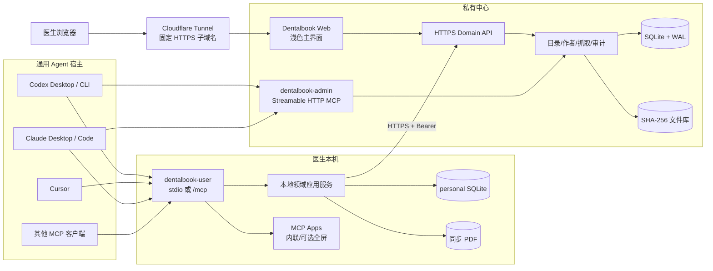

# Dentalbook v5 架构

## 1. 总体结构



## 2. 组件职责

### `dentalbook-user`

医生只配置一个用户 MCP。通用协议面是 Streamable HTTP：`POST /mcp`，Bearer 为当前用户中心令牌，默认只绑定回环。stdio 是同一工具目录的本机适配器，供 Codex 插件和 Cursor 项目配置使用。模块命名空间保持 `system`、`notebooks`、`papers`、`evidence`、`citations`、`reviews`、`authors`、`sync` 与 `ui`，但模块不等于微服务。网关负责协议适配、参数验证、错误翻译和 UI 资源发布，不实现业务规则。个人 PDF 缓存和本地上传仍在医生本机，因此第一版不把完整用户 MCP 发布到 `dentalbook.example.com/mcp`；该路径只作为后续远程只读适配器的预留入口。

### 本地领域应用服务

未来承载跨模块用例，例如“查询中心目录 → 检查本地文件 → 获取全文 → 更新笔记本 → 返回单一回执”。一次业务动作由一个应用服务方法完成，不能要求模型串联多个工具来保证事务。

### 中心领域服务

维护共享论文目录、作者图、受控全文、抓取任务、changeset 与审计。v1 使用 SQLite/WAL 和内容寻址文件系统；仓储接口隔离，为规模扩大后的数据库迁移留出边界。

### Dentalbook Web

医生浏览、搜索和下载文献的稳定主界面。有 `admin:audit` 的管理员还可打开用户文件夹，查看用过的 Agent，以及按时间交错的检索词和文献请求。有 `authors:admin` 的管理员另有「作者消歧审核」（`/author-merges`），按作者查看五路检索与作品并集；该面不是用户请求文件夹。静态资源与浏览器 API 由中心服务提供；长期 Token 只用于建立短期 HttpOnly 会话。Web 不读取 SQLite 或 PDF 路径，只调用与 MCP 共用的领域服务。公网入口通过 Cloudflare Tunnel 映射到 Linux 回环地址。

### `dentalbook-admin`

独立权限面，不混入医生 MCP。生产形态使用 HTTPS Streamable HTTP MCP。当前代码提供带 Bearer 门禁的共享统计、管理员 Fetch、作者关系审核，以及作者元数据合并审核（`admin.authors.list_merges` / `get_merge` / `review_merge`）；不注册 `authors.resolve` 或 hydrate。其他管理写入仍未实现。

### MCP Apps

UI 是 MCP 工具结果的视图，不是数据库客户端。业务状态属于领域服务；iframe 只保存选择、筛选、缩放和展开等临时状态。

## 3. 依赖方向

```text
Web / MCP / CLI / MCP App
        ↓
应用服务（用例、事务、权限、回执）
        ↓
领域模型（论文、证据、引用、作者、changeset）
        ↓
仓储与外部适配器（SQLite、文件、HTTPS、抓取器）
```

任何上层入口不得绕过应用服务直接写库。领域层不导入 MCP、React 或宿主特定 API。

## 4. 数据所有权

| 数据 | 权威位置 | 可复制位置 |
|---|---|---|
| 论文题录、作者图、全文许可 | 中心 | 本地只读缓存 |
| 受控全文文件 | 中心内容库 | 获准用户本地同步副本 |
| 笔记本、阅读状态、个人高亮、综述 | 本地 | 未来可选加密备份 |
| 公共作者修订 | 中心 changeset | 本地展示缓存 |
| MCP App 选择/筛选 | iframe 内存 | 不作为业务真相 |
| Web 会话与筛选 | 中心内存 / 浏览器内存 | 会话可失效，不作为业务真相 |

## 5. 写入与确认

普通写入返回结构化 `Receipt`。高风险动作采用两段式调用：

1. 调用业务工具但不带确认令牌。
2. 服务端校验参数与权限，返回 `confirmation_required`、一次性令牌、摘要和过期时间。
3. Agent 向用户展示准确影响范围。
4. 用户确认后，使用相同参数和令牌重试。
5. 服务端核对用户、动作、参数哈希和有效期，提交事务并返回 changeset/receipt ID。

确认逻辑必须位于服务端，不能只写在 Skill 提示中。

## 6. 当前实现边界

当前已实现共享目录、中心/本地 PDF 状态、用户本地 PDF 上传、管理员 fixture Fetch、内容寻址中心对象、同一 DOI 下并列多版本 PDF、本地同步、共享文献库 MCP App，以及独立浅色 Web 的列表（含元信息/PDF 两步入库角色/时间/渠道、多版本下载；元信息时间与渠道落在 `papers` 首次写入列上，后补 PDF/enrichment 不覆盖；论文栏 keywords 绿/黄/灰：有词直接显示、问过为空淡黄、未问为灰）、下载、作者名录三层（中文名、英文别名合集、论文索引）与五路来源胶囊（v3 / ORCID / OpenAlex / Crossref / PubMed：问过有命中为绿、问过为空淡黄、未问为灰；v3 名录导入即绿）、待审作者关系，以及管理员按作者审核的元数据合并（v3 名录为起点，ORCID/OpenAlex/Crossref/PubMed 补全核对，`author_works` 快照无外键，库中无 DOI 才补仅题录；`authors.get` 读时按规范化 DOI 对照 `papers`，不写 `paper_authors`）。`authorId` 为登记时快照 `{国家}.{学校}.{医院}.{学科}.{local}`（如 `cn.demo.hosp.omfs.001`）；现职码在列上；v3 旧号进 `author_id_aliases`。离线 `npm run import:v3-authors` 可从 v3 名录 mint 全量作者 JSONL（不进 Git、不配作品、不建 merge run）；第二趟 `npm run import:v3-author-works` 按 ORCID 或姓名+机构把 v3 题录并入 `author_works` 并记 `author_source_events`（名录/论文两次 v3 时间；待核定且无 ORCID 不配文）。作者消歧是选定的人→文 assignment，不从论文聚类造人，也不注册 `authors.resolve` / hydrate。同名（刘洋/韩冰）本版不自动消歧，须用 `authorId` 或旧号人工确认。抓取外部网站、笔记本、证据、引用、综述、师承/行政/单位维表、共著次数、作者图及生产级许可/下架策略仍未实现。作者库不从 PDF 入库自动建档。不导 v3 全库题录。
