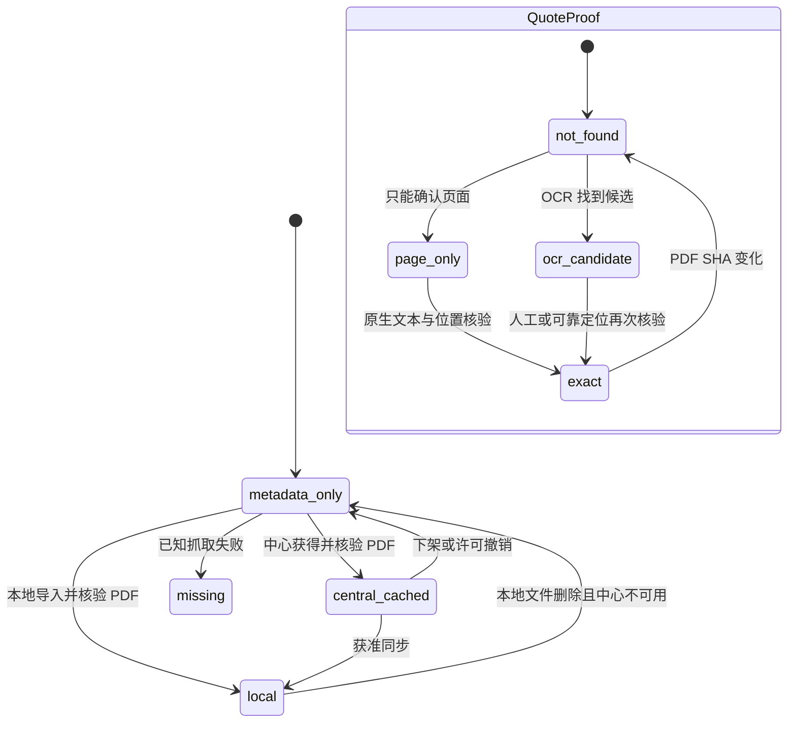

# Dentalbook Verified Citation

## 1. 保证范围

Dentalbook Verified Citation 证明“引用指向哪个文件、哪一页、哪段文字，以及证明何时产生”。它不保证 Agent 对原文的解释必然正确，也不把相关性自动升级为因果性。

## 2. 两级证明

```ts
type PdfProof = {
  status: "local" | "central_cached" | "metadata_only" | "missing";
  fileSha256?: string;
  byteSize?: number;
  mimeVerified: boolean;
  verifiedAt?: string;
};

type QuoteProof = {
  status: "exact" | "page_only" | "ocr_candidate" | "not_found";
  paperId: string;
  fileSha256: string;
  pageIndex: number;
  printedPageLabel?: string;
  exactQuote?: string;
  quoteSha256?: string;
  rects?: Array<{ x: number; y: number; width: number; height: number }>;
  textSource: "native_pdf" | "ocr" | "html";
};
```

代码中的共享契约位于 `packages/domain-contracts/src/index.ts`。

## 3. 状态机



## 4. 核验算法约束

### PDF

1. 文件真实存在且可读。
2. 文件头符合 PDF 魔数；扩展名或 HTTP MIME 不足以证明。
3. 对完整字节计算 SHA-256，并记录大小和核验时间。
4. 中心缓存还要记录来源、许可、上传者和访问策略。

只有完成以上步骤，才能显示“PDF 已核验”。`metadata_only` 只能显示“仅题录”。

### 原句

1. `paperId` 与当前论文匹配。
2. `QuoteProof.fileSha256` 与所引用那一份文件的 SHA-256 完全相同（对应 `pdfs[]` 或单版本 `PdfProof.fileSha256`）。
3. `pageIndex` 使用从 0 开始的机器页；`printedPageLabel` 仅供显示。
4. `exactQuote` 归一化后计算 `quoteSha256`，并能在相同文件的页面文本或 HTML 源中重现。
5. `rects` 与同一页渲染坐标系绑定；页面缩略图必须来自相同文件 SHA。
6. OCR 自动命中首先是 `ocr_candidate`，不得直接显示 exact。

PDF 字节变化会使旧 `QuoteProof` 失效。重新定位成功前显示未验证，而不是沿用旧页码。

## 5. `citations.verify` 回执

未来只有 `citations.verify` 成功回执能产生 `dentalbook_verified`：

```json
{
  "ok": true,
  "receiptId": "verify_...",
  "data": {
    "citationId": "citation_...",
    "verification": "dentalbook_verified",
    "pdfStatus": "local",
    "quoteStatus": "exact",
    "fileSha256": "...",
    "verifiedAt": "..."
  }
}
```

模型自行声称“我检查过原文”不能替代此回执。

## 6. 写作门禁

- 医学事实、综述正文和正式结论默认要求 `dentalbook_verified`。
- 只有题录：写“找到题录但没有 PDF”。
- PDF 存在但句子未定位：写“PDF 存在但该句话尚未定位”。
- OCR 候选：明确标为候选，不使用“精确原句”。
- 若用户明确要求先写草稿，可生成带 `[证据待核验]` 标记的非正式草稿，但不能称为可信综述。

## 7. 显示

UI：

```text
[12] Lee 2024
PDF ● 已核验    原句 ● 已定位
本地已同步      p.7 · 查看出处
```

无 UI：

```text
[12] Lee 2024 — PDF verified; exact quote verified on p.7
```
